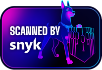

# @vanduo-oss/vd3

<a href="https://snyk.io/?utm_source=open-source&utm_medium=pg-ptr&utm_campaign=ref-2501-osp&utm_content=pg-cta"></a>

[](./LICENSE)

Vanduo UI for Vue 3: design tokens, CSS, and typed `Vd*` components. Sole peer: `vue >=3.3`. No Pinia.

**Status: 1.8.2.** Long guides live at [vd3.vanduo.dev](https://vd3.vanduo.dev/). Agents use [SKILL.md](./SKILL.md). Release notes are in [CHANGELOG.md](./CHANGELOG.md).

## Install

```sh
pnpm add @vanduo-oss/vd3
```

## Usage

Import the stylesheet, register the plugin, and render named components. The plugin does not register components globally.

```ts
import { createApp } from "vue";
import { VanduoVue } from "@vanduo-oss/vd3";
import "@vanduo-oss/vd3/css";
import App from "./App.vue";

createApp(App).use(VanduoVue).mount("#app");
```

`app.use(VanduoVue, { themeDefaults, storagePrefix })` overrides the baseline before the theme model reads it, and remaps the six `localStorage` keys (default prefix `vanduo-`).

```vue
<script setup lang="ts">
import { VdButton, VdCard } from "@vanduo-oss/vd3";
</script>

<template>
  <VdCard>
    <VdButton variant="primary">Save</VdButton>
  </VdCard>
</template>
```

## Components and composables

Named exports only.

- **64 components** — 57 `Vd*` components plus 7 layout primitives (`VdBox`, `VdCenter`, `VdCover`, `VdFrame`, `VdInline`, `VdStack`, `VdSwitcher`).
- **40 composable modules** — the theme API (`setThemeDefaults`, `useThemeBridge`, and the `useThemePreference` singleton), plus form, overlay, motion, and layout helpers. `sanitizeHtml` is exported too.

Per-component props are in [SKILL.md](./SKILL.md) and the [docs](https://vd3.vanduo.dev/).

## Theming

`applyPreference` and `useThemePreference` set six attributes on `<html>`: `data-palette`, `data-primary`, `data-neutral`, `data-radius`, `data-theme`, `data-font`. CSS resolves those into `--vd-*` custom properties. Preferences persist as `vanduo-palette`, `vanduo-primary-color`, `vanduo-neutral-color`, `vanduo-radius`, `vanduo-theme-preference`, and `vanduo-font-preference`. `storagePrefix` (or `setStoragePrefix`) changes that prefix. There is no migration between prefixes. Apps that share one module instance share theme state.

Text fonts are not bundled. `data-font` selects a stack; the host supplies `@font-face`, or stays on `system`. Pass `fontOptions` before the theme model reads storage, and include the default font key. `family` and `mono` write `--vd-font-family-sans` / `--vd-font-family-base` and `--vd-font-family-mono`. Omit them to keep the `[data-font]` rules.

Token data (`DEFAULTS`, `PALETTE_OPTIONS`, `tokens`) is re-exported from the package root. Raw JSON is `@vanduo-oss/vd3/tokens.json` (a flat CSS-variable map, not a DTCG interchange file). `@vanduo-oss/vd3/css/core` is the full component stylesheet without icon fonts.

Filled primary surfaces use `--vd-text-on-primary` and `--vd-text-on-primary-hover`. Status fills use `--vd-text-on-status`. `--vd-text-inverse` is the dark-surface token, not on-fill ink.

## SSR

Browser access is client-guarded (`typeof window`, `onMounted`, `onScopeDispose`). Nothing touches `window`, `document`, `localStorage`, or `matchMedia` during server render. `useThemePreference` seeds from defaults on the server and hydrates from storage on the first client call. Theme preferences and toast queues are module-wide: static SSR shells work, and request-specific mutations are not isolated. A storage prefix is not per-request state.

## Security

This repo is monitored with [Snyk](https://snyk.io/?utm_source=open-source&utm_medium=pg-ptr&utm_campaign=ref-2501-osp&utm_content=pg-cta).

- Zero runtime dependencies beyond the `vue >=3.3` peer. No Pinia.
- Hardened `.npmrc`: `ignore-scripts`, `minimum-release-age`, `save-exact`, `strict-peer-dependencies`, `trust-policy=no-downgrade`, `block-exotic-subdeps`, and an explicit `registry`.
- [MIT](./LICENSE). Third-party notices: [THIRD-PARTY-LICENSES](./THIRD-PARTY-LICENSES) (Open Color, Phosphor Icons, and the adapted expanding-cards CSS).

## Exports

| Export | Contents |
| --- | --- |
| `@vanduo-oss/vd3` | Components, composables, theme API, token data |
| `@vanduo-oss/vd3/highlight` | Optional `highlightCode` / `highlight` helpers |
| `@vanduo-oss/vd3/css` | Full stylesheet (`dist/vd3.min.css`) |
| `@vanduo-oss/vd3/css/core` | Full stylesheet without icon fonts (`dist/vd3-core.min.css`) |
| `@vanduo-oss/vd3/tokens.json` | Resolved flat CSS-variable data (`dist/tokens.json`) |

## Development

Node 26 LTS (`nvm use` from `.nvmrc`) and pnpm 10.28.2. `engines.node` `>=20.19.0` is the consumer floor, not the development runtime. Bootstrap with `pnpm install && pnpm build:tokens`, then the gates in [CONTRIBUTING.md](./CONTRIBUTING.md).

## Documentation

- [vd3.vanduo.dev](https://vd3.vanduo.dev/)
- [SKILL.md](./SKILL.md) — agent reference
- [CHANGELOG.md](./CHANGELOG.md)
- [CONTRIBUTING.md](./CONTRIBUTING.md)

## License

[MIT](./LICENSE) © Vanduo
